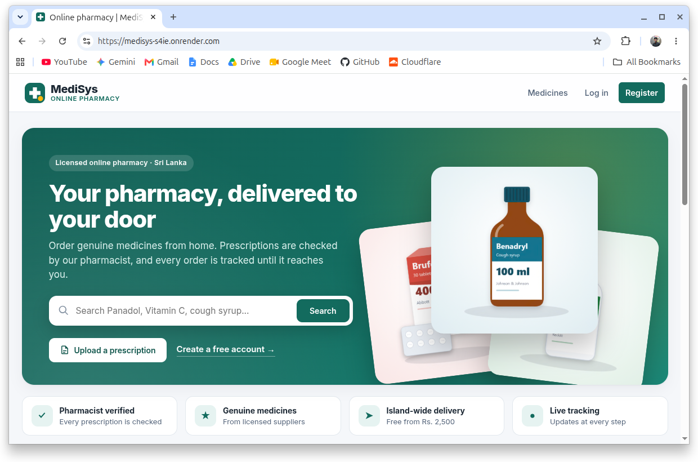
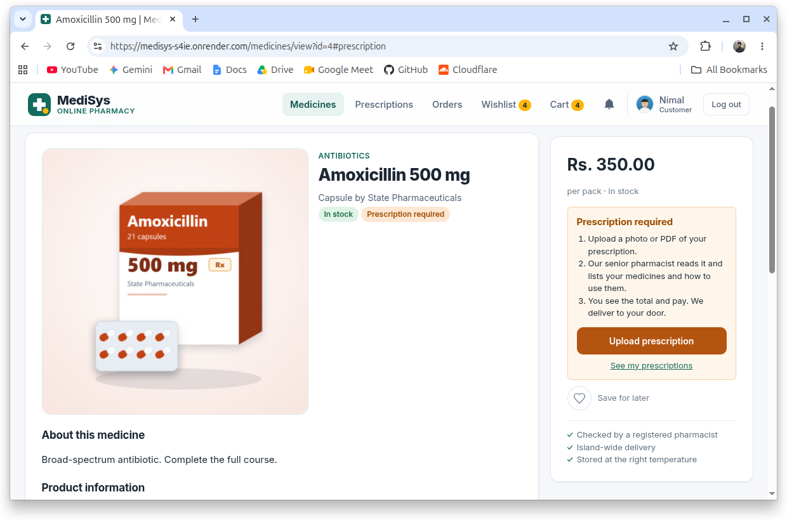
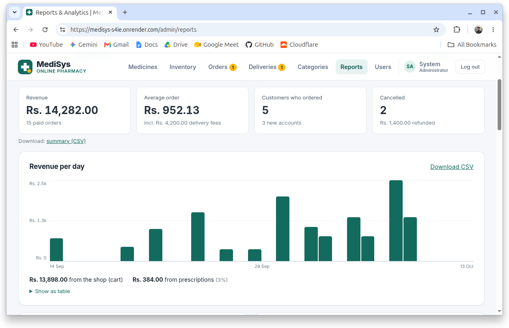
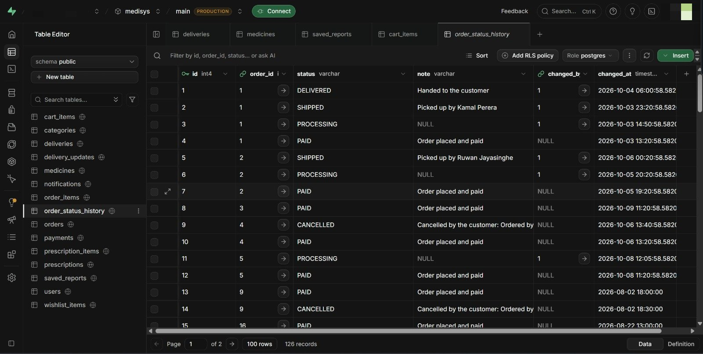
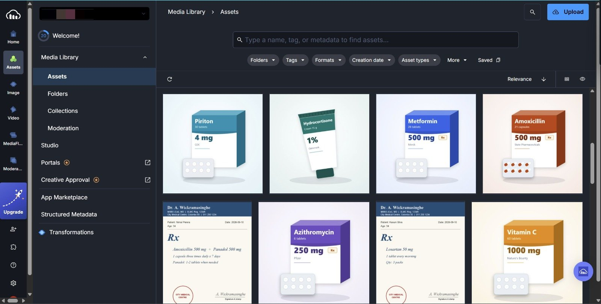
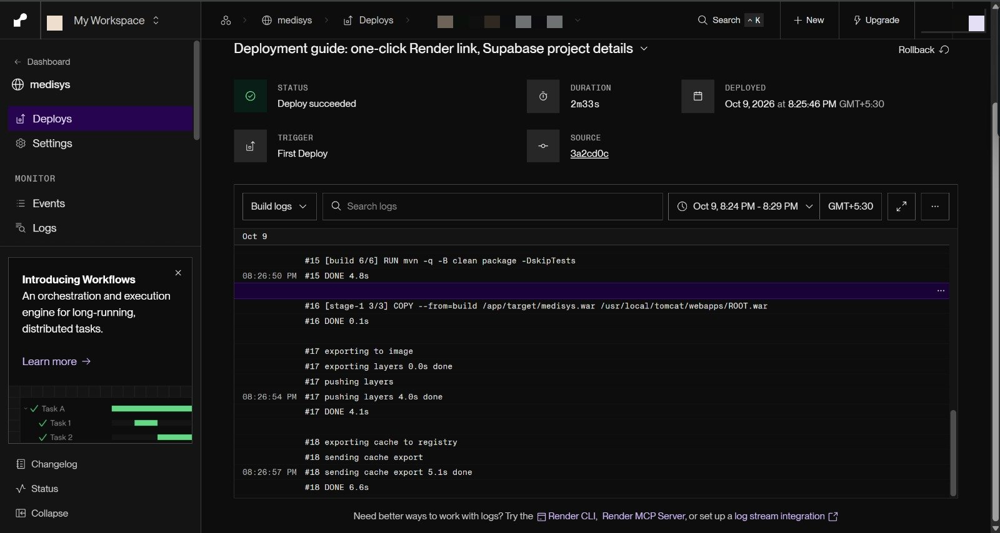
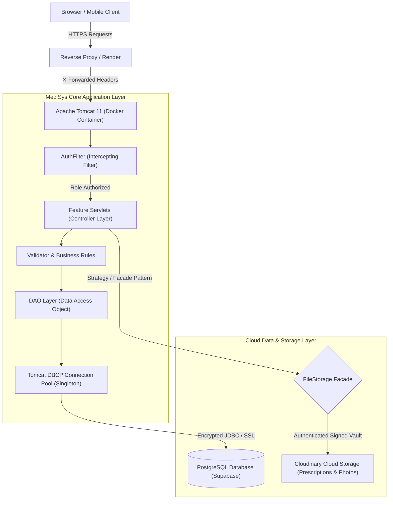

# 💊 MediSys: Enterprise Online Medicine Ordering Platform

[](https://medisys-s4ie.onrender.com)
[](https://openjdk.org/)
[](https://jakarta.ee/)
[](https://tomcat.apache.org/)
[-336791?style=for-the-badge&logo=postgresql&logoColor=white)](https://supabase.com/)
[](https://cloudinary.com/)
[](https://www.docker.com/)
[](LICENSE)

> A production-deployed Java web platform engineered for prescription-verified online pharmaceutical distribution, authenticated clinical triage, real-time rider dispatch tracking, and transactional inventory lifecycle management.

---

## 🌐 Live Deployment & Interactive Demo

The platform is live and fully accessible:
👉 **[https://medisys-s4ie.onrender.com](https://medisys-s4ie.onrender.com)**

### Role-Based Demo Credentials

You can test the end-to-end clinical and delivery workflow using pre-configured accounts:

| Role | Email Address | Password | Permissions & Capabilities |
| :--- | :--- | :--- | :--- |
| **System Administrator** | `admin@medisys.lk` | `Admin@123` | Full user management, rider assignment, medicine inventory control, and financial reporting |
| **Clinical Pharmacist** | `pharmacist@medisys.lk` | `Pharma@123` | Prescription triage queue, medicine dosage assignment, prescription approval / rejection / correction requests |
| **Customer** | `nimal@example.com` | `Customer@123` | Medicine catalog browsing, cart & wishlist, prescription uploads, checkout, order tracking |
| **Delivery Rider** | `delivery@medisys.lk` | `Delivery@123` | Assigned parcel dashboard, dispatch pickup, sequential delivery status progression, delivery attempt logging |

> **Payment Simulation:** Use card number `4242 4242 4242 4242` with any future MM/YY and any 3-digit CVV for simulated transactions.

---

## 📸 Application Showcase & Architecture Highlights

### 🖥️ Customer & Clinical Workflow

| 🛒 Storefront & Medicine Catalog | 📋 Prescription Validation Gate |
| :---: | :---: |
|  |  |
| *Patient-facing catalog featuring real-time stock availability, search filtering, and category navigation* | *Mandatory clinical prescription upload gate protecting regulated pharmaceutical items* |

### 📊 Executive Analytics & Inventory Intelligence

| 📈 Real-Time Financial & Inventory Analytics Dashboard |
| :---: |
|  |
| *Executive KPI dashboard displaying total revenue, completed orders, pending deliveries, top-selling items, and low-stock warnings* |

### ☁️ Cloud Infrastructure & Production Architecture

| 🗄️ Supabase PostgreSQL Cloud Database | ☁️ Cloudinary Secure Media Vault |
| :---: | :---: |
|  |  |
| *Normalized relational database schema with ACID guarantees, foreign-key integrity, and SSL connection pooling* | *Cloud asset storage managing customer-uploaded prescriptions and product catalog media with signed URLs* |

| 🚀 Automated Multi-Stage Docker CI/CD on Render |
| :---: |
|  |
| *Continuous deployment pipeline executing multi-stage Docker builds on push to main with live health checks* |

---

## 🏗️ System Architecture & Request Lifecycle



---

## 📦 Core Functional Modules

The platform is architected into modular domain packages within `src/main/java/com/medisys/`:

| Module | Lead Developer | Domain Package | Key Architectural Capabilities |
| :--- | :--- | :--- | :--- |
| **01. Shopping Cart & Wishlist** | Amadini G. G. A. | `com.medisys.cart` | Concurrency-safe atomic updates (`UNIQUE (user_id, medicine_id)`), dynamic stock caps, prescription-required guard validation, and seamless JSON/HTML asynchronous replies. |
| **02. Order Placement & Checkout** | Hewage B. H. A. S. | `com.medisys.order` | Atomic multi-table checkout transactions (`orders`, `order_items`, `deliveries`), stock level decrements, simulated card processing, and order status lifecycle. |
| **03. Medicine Catalog & Inventory** | **Divisekara A. W. D. M. D. M. B.** | `com.medisys.medicine` | Category taxonomy, stock threshold monitoring, batch expiration tracking, product media synchronization to Cloudinary, and catalog search/filtering. |
| **04. Reports & Business Analytics** | Kaweesha P. M. G. S. | `com.medisys.report` | Temporal financial aggregation (Daily, Weekly, Monthly), top-selling medicine rankings, low-stock warnings, and persistent report exports. |
| **05. Prescription Triage & Verification** | Perera D. A. A. N. S. | `com.medisys.prescription` | Secure multi-format upload (PDF/PNG/JPEG) to authenticated cloud storage, clinical review queue, prescription itemization, and interactive correction upload workflow. |
| **06. Rider Dispatch & Delivery Tracking** | Deshabhi R. G. S. | `com.medisys.delivery` | Strict finite-state delivery progression (`PENDING` $\rightarrow$ `PACKED` $\rightarrow$ `PICKED_UP` $\rightarrow$ `OUT_FOR_DELIVERY` $\rightarrow$ `DELIVERED`), rider re-assignment, failed attempt logging, and instant notification dispatch. |
| **User & Authentication** | Core Team | `com.medisys.user` | PBKDF2 salted password hashing, role-based access control, profile management, and account status flagging. |

---

## 🏛️ Software Design Patterns

The system implements classic GoF and enterprise patterns to maintain strict separation of concerns:

| Design Pattern | Key Implementation Class | Architectural Rationale |
| :--- | :--- | :--- |
| **Model-View-Controller (MVC)** | `Medicine`, `CatalogServlet`, `catalog.jsp` | Decouples business logic from view rendering. Servlets handle routing and validation; JSPs reside securely in `/WEB-INF/views/` protected from direct URL access. |
| **Data Access Object (DAO)** | `MedicineDAO`, `OrderDAO`, `UserDAO` | Encapsulates all SQL execution within dedicated classes using parameter-binding `PreparedStatement` to ensure complete protection against SQL injection. |
| **Singleton Pattern** | `DBConnection.java` | Manages a single shared Tomcat DBCP connection pool across the application lifecycle to eliminate expensive connection renegotiation overhead. |
| **Strategy Pattern** | `StorageStrategy`, `CloudinaryStorage`, `LocalStorage` | Enables seamless switching of file storage providers between cloud CDN (production) and local disk (development) via configuration flags without touching business logic. |
| **Facade Pattern** | `FileStorage.java` | Presents a unified high-level storage API (`save`, `open`, `delete`) to calling servlets while abstracting strategy selection and security token signing. |
| **Intercepting Filter** | `AuthFilter.java` | Centrally enforces authentication state and URL role constraints prior to servlet execution. |
| **Post/Redirect/Get (PRG)** | Form submission servlets | Prevents duplicate form submissions on browser refresh by concluding write requests with 302 redirects paired with flash session messages. |

---

## 🛠️ Technology Stack & Cloud Infrastructure

- **Backend Runtime:** Java 17+, Jakarta Servlet API 6.1.0, Apache Tomcat 11.0.0
- **Database:** PostgreSQL on [Supabase](https://supabase.com) (Session pooler with SSL encryption)
- **Media Storage & CDN:** [Cloudinary](https://cloudinary.com) (Private authenticated tokens for sensitive medical records; public CDN for catalog assets)
- **Containerization:** Multi-stage Docker image (`maven:3.9-eclipse-temurin-21` $\rightarrow$ `tomcat:11.0-jdk21-temurin`)
- **Hosting Platform:** [Render](https://render.com) (Continuous deployment linked to `main` branch)
- **Reliability:** Automated GitHub Actions keep-alive workflow to prevent cold-starts

---

## 🚀 Local Development Setup

### Prerequisites
- **JDK 17** or newer
- **Apache Tomcat 11**
- **Maven 3.8+** (or IntelliJ IDEA with bundled Maven)
- **PostgreSQL 16+** (local or cloud instance)

### 1. Clone Repository
```bash
git clone https://github.com/dulithdivisekara/drug-ordering-system.git
cd drug-ordering-system
```

### 2. Configure Database & Environment
Copy the example properties file and configure your credentials:
```bash
cp src/main/resources/db.properties.example src/main/resources/db.properties
```

Edit `src/main/resources/db.properties`:
```properties
db.url=jdbc:postgresql://localhost:5432/medisys
db.user=postgres
db.password=your_password
```

Initialize the database schema and sample data:
```bash
psql -U postgres -c "CREATE DATABASE medisys;"
psql -U postgres -d medisys -f database/schema.sql -f database/sample-data.sql
```

### 3. Build & Run
Build the deployable WAR artifact:
```bash
mvn clean package
```

Run via Docker:
```bash
docker build -t medisys .
docker run -p 8080:8080 \
  -e DB_URL="jdbc:postgresql://<host>:5432/medisys" \
  -e DB_USER="<user>" \
  -e DB_PASSWORD="<password>" \
  medisys
```
Open **`http://localhost:8080`** in your browser.

> For comprehensive code walkthroughs, consult [`ARCHITECTURE.md`](ARCHITECTURE.md). For cloud infrastructure guides, see [`DEPLOYMENT.md`](DEPLOYMENT.md).

---

## 👥 Contributors & Module Leads

| Contributor | Research & Development Role | Module Ownership |
| :--- | :--- | :--- |
| **Divisekara A. W. D. M. D. M. B.** | Core Contributor | Medicine Catalog & Dynamic Inventory |
| **Amadini G. G. A.** | Core Contributor | Shopping Cart & Concurrency-Safe Wishlist |
| **Hewage B. H. A. S.** | Core Contributor | Order Placement & Transactional Checkout |
| **Kaweesha P. M. G. S.** | Core Contributor | Executive Reporting & Analytics Dashboard |
| **Perera D. A. A. N. S.** | **System Architect & Lead** | Prescription Triage & Verification Workflow |
| **Deshabhi R. G. S.** | Core Contributor | Rider Dispatch & Delivery Tracking |

---

## 📄 License

This project is licensed under the [MIT License](LICENSE) — see the LICENSE file for details.
